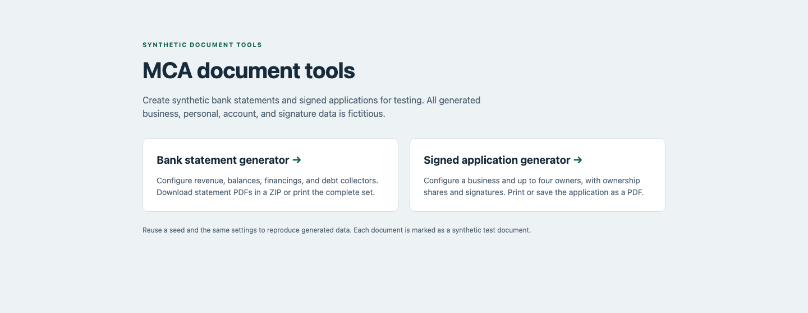
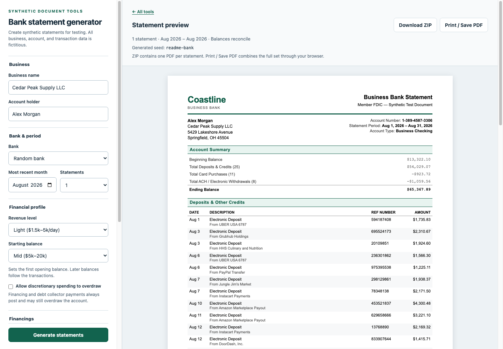
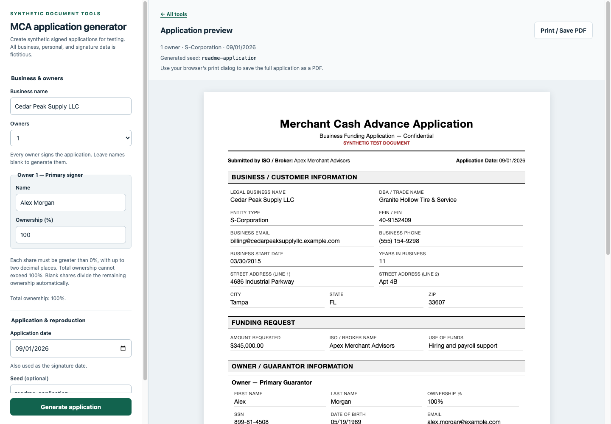

# MCA document tools

Standalone browser tools for generating synthetic bank statements and signed
merchant cash advance (MCA) applications. Use them to exercise document processing,
reconciliation, and OCR workflows with reproducible sample data.

Generation happens in the browser. All documents carry synthetic-test markings.
Revenue tiers, financing schedules, and ownership options define sample scenarios.

## Screenshots

### Tool selection



### Bank statement generator



### Signed application generator



## How To Run

Open `site/index.html` in your browser and choose a generator. No server, build, or
installation is needed to use the tools, so you can share the folder as is. PDF export
loads its libraries from cdnjs, so it needs an internet connection.

If you change any JavaScript under `site/assets/js/<tool>/` or `shared/`, rebuild the
browser bundles with Node.js 22 or later:

```sh
npm run build
```

Browsers won't load JavaScript modules from `file://`, so each page loads one generated
classic script (`site/assets/js/<tool>.bundle.js`) built from the modules. Edit the
modules, never the bundles. `npm test` fails if a bundle is out of date.

Run the regression suite with Node.js 22 or later:

```sh
npm test
```

The suite uses Node's built-in test runner and has no external dependencies.

## Structure

- `site/` contains the complete frontend. Its landing page links to
  `bank-statements/` and `mca-applications/`; all local URLs are relative so a
  nested path works as well as a domain root.
- `site/assets/css/` contains the shared application shell and separate landing,
  bank-document, and application-document styles. Each tool owns its print rules.
- `site/assets/js/shared/` contains seeded randomness, formatting and HTML
  escaping, configuration errors, and accessible UI feedback/dropdown helpers.
- Each tool's JavaScript directory separates catalogs (`data.js`), pure generation
  and validation (`generation.js`), pure document markup (`rendering.js`), and
  browser orchestration (`main.js`). The bank tool additionally owns `pdf.js`.
- `tests/` contains regression checks and frozen baseline fixtures. It is not part
  of the website and uses only files included in this project.

The controllers maintain independent draft settings and generated results. Only
Generate applies edits; invalid settings preserve the existing preview. Generated
data and rendered document HTML are reproducible with the same explicit settings
and seed. Preserve random draw order and catalog order when
making changes that should keep existing seeds compatible.

The bank page retains html2canvas 1.4.1, jsPDF 2.5.1, and JSZip 3.10.1 from the
existing cdnjs URLs for ZIP/PDF export. Its browser printing remains available if
those libraries cannot load. The two exports differ in kind: **Download ZIP** PDFs are
images of the page (html2canvas), while **Print / Save PDF** produces a text PDF with
embedded fonts, which is closer to a real bank's PDF. The application and landing pages have no external
runtime dependencies. No backend, persistence, or integration service is added.

## Revenue Scenarios

Choose **Below $10k/month** in the bank generator’s **Revenue level** dropdown to
keep average monthly deposits below $10,000 for any supported statement count.
This tier allows at most one $100–$300 deposit per calendar day, so even a 31-day
month totals no more than $9,300. Each month stays below the threshold individually.
The combined deposits across several months may exceed $10,000.

The preview reports total ledger deposits divided by the number of statements;
starting balances are excluded. Existing revenue tiers retain their behavior.

## Account Type

The bank generator's **Account type** dropdown chooses what kind of checking account
the statements describe. Layout and the `To <funder> - Merchant Advance Pmt` financing
wording are the same for every type, so MoneyThumb OCR handles all of them.

- **Business account** (default) is the original behavior: business deposits and
  vendors, "Business Bank Statement" and "Business Checking".
- **Personal, business income commingled** models a sole proprietor whose income lands
  in personal checking: about 65% of deposits use the business-style sources and the
  rest are personal ones (Zelle, Venmo, Cash App, payroll). Spending is personal
  (groceries, gas, streaming, personal cards) plus one rent or mortgage payment per
  statement. All revenue levels are available.
- **Personal, personal income only** has only personal deposits and supports the
  Below $10k and Very Light revenue levels.

Personal statements read "Personal Bank Statement" and "Personal Checking" with a
personal bank tag. They print the account holder only; **Show DBA line** adds a
`DBA <business name>` line under the holder name and in the footer. Personal spending
uses fixed dollar amounts sized for the Below $10k level, scaled up for richer tiers.
Each personal run draws one rent or mortgage payee and amount (sized to the revenue
level) and repeats it every month within a day or two of the same date; it posts even
when it overdraws a low balance. Financing and collector payments still scale with the revenue level.

Generation results gain an `accountType` key only for personal types, so business seeds
and their stored baselines are unchanged.

## Collector Catalog

Ten fictional collector agencies and their statement aliases are embedded in the
bank's `data.js` as `{ name, aliases }` records. Their names begin with “Example”
and are not intended to identify real agencies. Update this catalog directly to
customize the sample transactions. No external document or account access is required.

## OCR Compatibility

The bank-statement layout is intended for MoneyThumb OCR testing. No MoneyThumb
API integration is included. The automated tests validate generated arithmetic,
document rendering, and export behavior; they do not verify OCR classification.

Every financing debit reads `To <funder> - Merchant Advance Pmt`. MoneyThumb doesn't know
the fictional funder names, so it relies on the "Merchant Advance" phrase to tag the debits
as MCA payments. Without the phrase, no financing reaches the bank summary.

Each statement names the product (for example "Business Checking") above the account
number, in the summary heading, and in the footer, the way real statements do. With these
labels, MoneyThumb returns `accounttypestr` (confirmed for Checking on 2026-11-04, image PDF,
fictional bank). Before them it returned an empty value.

The **Product** dropdown picks Checking (default), Savings, or Credit Card. It changes only
the labels ("Business Savings", "Business Credit Card Statement"); transactions are the same
for every product. Credit Card is a label test, not a real card layout (no credit limit,
minimum payment, or purchases-and-payments format). Results gain a `product` key only for
non-checking products, so existing seeds and baselines are unchanged.

## Validation

The regression suite checks exact seeded data/document parity, shared randomness,
ledger continuity and reconciliation, calendar boundaries, financing and collector
payments, presentation-only corruption, personal account types (reconciliation,
revenue-tier limits, DBA rendering, deposit-source mix), and application ownership
and signatures.
Fixed-seed expectations are stored in `tests/fixtures/generation-baselines.json`.

For UI changes, open the site from `file://` and from a static HTTP host, then check navigation,
pending settings, inline errors, keyboard focus, narrow screens, and printing.
Export checks should cover one and six statements, dense activity, ZIP filenames,
locking and failure recovery, plus one- and four-owner signed applications.

## Hosting

Open `site/` directly or serve it from any static HTTP host. The project requires no
server-side application or platform-specific configuration. Commit rebuilt bundles with
the module changes. Keep future tool
additions separate while extracting genuinely common helpers.
